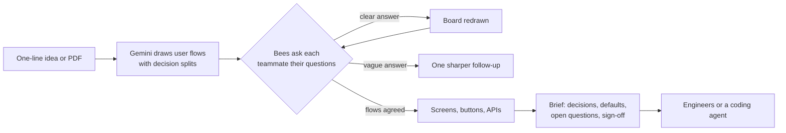

# BuildingBees

**Other tools guess. BuildingBees asks.**

Tools that turn one prompt into screens or diagrams have to guess everything the prompt leaves out. BuildingBees works the way a product team does: it maps the user flows first, then six bees ask what the idea leaves out (a solo founder answers a set of 3 to 7 at a time; a team answers one at a time, each person for their own role). Anyone can comment on any card, and the board changes only when you press Update the board: work moves in review rounds (on a team board, the owner processes each round). Every flow, screen, button, API and feature has a short id (FL1, S2, B3, A1, F1) shared by the board, the Brief and the export. New features can be added to the same board later. Screens are drawn only after the flows are agreed.

Live demo on Google Gemini: https://buildingbees-853213660594.asia-south1.run.app
Live demo on NVIDIA Nemotron (newest build): https://buildingbees-nemotron-853213660594.asia-south1.run.app

**Who it is for:** product teams in B2B software, first of all software agencies scoping fixed-price client work. A team shares one board: the client, the product manager, the designer, the engineers and the tester each answer only the questions that belong to them, and the client signs off the scope before anyone builds.



## For judges: try it in two minutes

Open the live link, pick **Just me**, and press **Try a sample in one click**, or paste one of these:
- "A home bakery app: customers order custom cakes, choose flavour and size, pay an advance; the baker sees the week's orders."
- "An app where parents see their child's attendance and test marks, pay monthly fees, and get a message when the child misses class."
- "A B2B tool where clients book and pay for consultations with advisors in a firm."

Then answer a round (or press Decide the rest for me), tap any step card to comment, press **Update the board**, **Draw the screens**, and open the **Brief** (Plan check at the top, Write the full plan, Share as a web page). No sign-in is needed.

**Limits, stated up front.** A first map takes about 20 to 40 s on Gemini 3.1 Pro. Solo rounds ask at most 6 questions. Agent Platform calls are capped at 300 a day; past that the free Gemini API key takes over, then Flash-Lite as an emergency, and the pill at the bottom shows which model answered.

**Guardrails and data.** Every model reply is validated against a Pydantic schema before it touches the board. `strip_guesses` removes vendors, timeouts and limits nobody stated, so they become questions. Web research (Tavily, the Scout Bee) is shown as a source, never counted as a decision. The only data is what the person types; boards live in Firestore.

**Technical problems we solved.** Each Gemini model has its own quota, so a fail-over chain across Agent Platform and the API key keeps the bees answering; rounds batch every answer and note into one call, so the board redraws once per round instead of after every answer; short ids (F1, FL1, S1, B1, A1) stay stable through redraws, so a coding agent can follow them.

## From plan to code: what a developer gets

Everything below is built from the board, with no extra model call, so it never says more than the team decided.

| Feature | Where | What it does |
|---|---|---|
| Play the flow | "Play the flow" on any flow with screens (key P) | Click through the screens like a working app, following each button's success screen, with its failure screen one tap away |
| What can go wrong | Zoom bar (key C) | Dims the happy path; failure screens and buttons that have one are outlined red, buttons that call an API with no failure screen are dashed |
| Build prompt | "Build prompt" on every screen | A paste-ready prompt for Cursor or Claude Code: the screen, its buttons, the APIs they call, the decisions, and open questions marked "do not guess" |
| API contract and live mock | Click any API | Method, path, example request and response, failure codes; a live mock at `/mock/<board>/<path>` returns the example (edit and save it to test edge cases) |
| OpenAPI 3.0 | Brief, "OpenAPI" | `openapi.json` for Postman, Swagger or type generators (also in the docs zip) |
| Test plan | Brief, TESTS tab | A happy path per flow, a scenario per failure screen, and the gaps still to decide |
| Database diagram | Brief, SCHEMA tab | The tables and how they link, drawn from the schema |
| Suggest a field change | API panel | Becomes a Backend question; the API changes only when the owner or backend lead approves it |
| Go back to an earlier point | Menu | A copy is kept before every round and before screens are drawn (last 5); going back is itself undoable |
| Desktop screens | Board and Play the flow | Staff and admin screens are tagged desktop and drawn wide |
| Share with team | Top bar on a solo board | Turns a solo board into a team board; the founder keeps running it, each teammate answers only their bee's questions |
| SVG export | Screen details | A plain SVG of the wireframe that Figma opens |

Each bee has talents, and a talent is a set of skills (`talents/<bee>/<talent>/<skill>/SKILL.md`). A skill is wired into the prompts only if it moves a measured number (`scripts/eval_skills.py`); today that is Shield's India pack (DPDP consent and GST), added automatically when the idea looks Indian.

## How it works

1. **Say what you want to build.** Two lines are enough. A PRD, a PDF, a call transcript, or a **photo of your whiteboard or napkin sketch** works too: Gemini reads the sketch with vision, keeps what it shows and the bees ask what it leaves out.
2. **Flows first.** The engine returns the users and their flows, step by step. No screens yet.
3. **The bees ask.** Each question belongs to one bee and points at one step of a flow.

   | Bee | Asks about |
   |---|---|
   | Queen Bee | who it is for, scope, success |
   | Design Bee | what the person sees and feels |
   | Frontend Bee | screen states, validation, failure behaviour |
   | Backend Bee | data, integrations, timeouts, retries |
   | Test Bee | edge cases and what goes wrong |
   | Compliance Bee | privacy, consent, rules |

4. **Every answer is read.** A vague answer ("everyone", "whatever is normal") gets one sharper follow-up and changes nothing. A clear answer rewrites the board: steps are added, changed or removed, a new flow appears if you asked for one, and the bee says what it did. You can change any answer; the bee takes back what the first one did.
5. **Draw the screens.** The agreed flows and every decision become screens with wireframes, buttons, and the APIs each button calls. The bees then ask again, screen by screen, and answers fill in the missing details (a timeout, a vendor, an empty state).
6. **Take the Brief.** One document with the flows, screens, every decision and what is still open. Copy it, download it, print it, or give your coding agent the link. It is a starting point an engineer or agent can work from, not a full technical design. Anything not decided is printed as `NOT DECIDED`, so the builder asks instead of assuming.

**Teams.** Everyone opens the same board link and picks a role: product manager (hears every bee), client (business and compliance questions only), designer, frontend, backend or tester. Each answer records who gave it, the board picks up teammates' answers every 15 seconds, and the Brief shows who decided what.

**The plan an agent builds from.** "Write the full plan" in the Brief adds user stories with "Given, when, then" acceptance criteria for every flow and branch, a feature list (must for v1, should, later), a build order of thin slices each with a done check, and a glossary. The Brief also keeps an **assumption log** of everything the bees filled in instead of asking. Export it all as Markdown or PDF.

**Standard answers are not asked.** Timeouts, retries, double taps, loading and error states have industry-standard answers, so they are filled in and listed in the Brief under "Standard defaults applied", where the team can change any of them. The bees ask only what depends on this product. (A tester answered 70+ questions on an early version; the same idea now gets 9.)

**Flows split.** A step can be a decision ("Payment went through?") drawn as a diamond, with the other path underneath. A path nobody has decided is drawn as "Not decided yet" and a bee asks about it; a path with a standard handling is drawn, not asked.

**Solo or team.** The start screen asks who will answer. One founder gets at most 6 questions per stage in everyday words, with the bees' recommended answer first and a plain "why"; the bees decide the technical points themselves. A team gets up to 12 per stage, each routed to the role that owns it and worded for that expert.

**Testers' feedback.** The Feedback button opens a public board for beta testers: report a bug or an idea with screenshots, upvote and comment; the team marks a fix deployed and three testers' "Confirm fixed" resolve it.

**Flows stay editable.** Once screens are drawn, a Flows / Screens switch brings the flows back; "Edit steps" changes a flow by hand, and the board offers to redraw the screens from it.

**Sign-off.** Anyone who owns part of the scope signs off the Brief. It records who and when, how many questions were still open, and says so if later decisions changed the scope.

A screen is "ready to build" only when it has no open blocking question, its loading and error states are decided, every API it calls has a timeout, and every button that calls an API says where a failure leads.

Values nobody stated are removed: if the engine fills in a vendor or a timeout that appears nowhere in what you wrote or answered, it is blanked and asked about.

## Engines

| Engine | Used for | Notes |
|---|---|---|
| Google Gemini | Google Cloud AI Builder Cup | Gemini API with structured output (`response_schema`) and native PDF input. Falls over to a second model when one is overloaded. |
| NVIDIA Nemotron | Nebius x NVIDIA Global AI Hackathon | NVIDIA Nemotron 3 on Nebius Token Factory (OpenAI-compatible API). See the section below. PDFs are converted to text first. |

Both engines fill the same Pydantic schemas (`src/adapters/spec_prompts.py`), so the board code does not care which one ran. The six bees are roles inside one engine call: the prompt assigns every question to the bee that owns that aspect. They are not six separate agents.

## NVIDIA Nemotron on Nebius Token Factory

### How Nemotron and Token Factory are used (Nebius x NVIDIA hackathon)

Live, Nemotron only: https://buildingbees-nemotron-853213660594.asia-south1.run.app (a Cloud Run service with only the
Nebius key). Every model call goes to NVIDIA Nemotron through the Token Factory API (`src/adapters/nvidia_adapter.py`),
routed by job the way the Best Apps and Agents track suggests: Ultra for the heavy reasoning, Super for everyday calls.

| Job | Model | Measured on the live service, 27 Oct 2026 |
|---|---|---|
| Draw the flows, splits, features and first questions from an idea or a sketch photo | `nvidia/Nemotron-3.5-Super-VL` (won an A/B against Ultra: same quality, about 5x cheaper, 2x faster) | 10.6 s of model time, 3,518 tokens in, $0.004 |
| Read a round of answers and notes, redraw the board | `nvidia/nemotron-3-super-120b-a12b` | about 4 s |
| Draw the screens, buttons and APIs; write the plan and the tech docs | `nvidia/Nemotron-3-Ultra-550b-a55b` | screens 11 s, $0.015; plan about 8 s; docs about 15 s |

What makes it work:

- **Native structured output.** Every call sends `response_format: {type: "json_schema"}`, so Token Factory's guided
  decoding can only produce JSON of our Pydantic schema; we still validate it and retry once with the error. If a model
  ever refuses the format, the adapter falls back to writing the schema into the prompt.
- **Thinking off** (`chat_template_kwargs: {enable_thinking: false}`): left on, Nemotron 3 spent its token budget
  reasoning and the JSON came back cut short.
- **Fallbacks and timeouts:** Ultra and Super VL back each other up; a busy Ultra hands over after 45 s and the backup
  gets 60 s, so a board never waits past Cloud Run's request limit.
- **Visible usage:** the engine pill on the board shows each call's model, seconds, tokens, prefix-cache hits (from
  `usage.prompt_tokens_details.cached_tokens`; prompts start with their fixed instructions so repeated calls share a
  cacheable opening) and cost.
- **Spend guard:** a daily ceiling (`NVIDIA_DAILY_BUDGET_USD`, default $1.50) from the token counts Token Factory returns,
  kept in Firestore so a cold start does not reset it. A whole board costs about $0.05.
- **Measured, not guessed:** model routing and every prompt change are scored by `scripts/eval_questions.py`
  (27 Oct, Nemotron: 12.0 questions per idea, 0 on standard topics, 0 near-duplicates); skills are wired only if
  `scripts/eval_skills.py` shows a gain. Nebius cannot fine-tune Nemotron, so the flows prompt was tuned with a
  keep-only-if-better loop (`scripts/optimize_prompt.py`).

## Scout Bee: research with Tavily

Before the bees ask anything, the Scout Bee runs one Tavily search on the idea (`src/adapters/tavily.py`) and hands up to five pages to the engine. The bees use them only to ask sharper questions: a rule that applies, a failure other products hit. A question that came from a page shows its source in the chat, and the Brief lists every page.

Research never becomes a decision. It is not added to the founder's spec, it cannot draw a flow, and a vendor named on a web page is still removed and asked about. The pages are passed to the engine as untrusted reference text. Without `TAVILY_API_KEY` the product works the same, minus the research.

## Run it locally

Requires Python 3.9 or newer.

```bash
python3 -m venv .venv
.venv/bin/pip install -r requirements-dev.txt
cp .env.example .env   # then add GEMINI_API_KEY and/or NVIDIA_API_KEY, and optionally TAVILY_API_KEY
.venv/bin/python -m uvicorn src.api.server:app --port 8000
```

Open http://localhost:8000. Run the tests with `.venv/bin/python -m pytest -q`.

## Deploy to Google Cloud Run

```bash
gcloud run deploy buildingbees --source . --region asia-south1 --allow-unauthenticated \
  --min-instances 0 --max-instances 1 --set-env-vars "GEMINI_API_KEY=...,GEMINI_MODEL=gemini-3.5-flash"
```

## Project layout

| Path | What it is |
|---|---|
| `web/index.html` | The whole web app: start screen, bee chat, flow and screen board, wireframes, Brief viewer |
| `src/api/server.py` | FastAPI app, one board per visitor |
| `src/adapters/spec_prompts.py` | Every prompt and output schema |
| `src/adapters/gemini_adapter.py`, `nvidia_adapter.py` | The two engines |
| `src/adapters/tavily.py` | The Scout Bee's web search |
| `src/core/ingest.py` | Turns engine output into the board |
| `src/core/graph.py` | The board and the readiness rule |
| `src/core/brief.py` | Writes the Brief (no model call) |
| `scripts/eval_questions.py` | Question-quality check: runs four sample ideas and flags standard-topic and duplicate questions |
| `docs/ARCHITECTURE.md` | How the pieces fit, for engineers and coding agents |
| `docs/research/` | The research prompts behind the product decisions |

## API

Every call takes the board id in an `X-Board` header or a `?board=` query parameter.

| Method | Path | Purpose |
|---|---|---|
| GET | `/api/status` | Which engines are connected |
| POST | `/api/ingest-prd?engine=` | Idea or spec text in, flows and questions out |
| POST | `/api/ingest-file?engine=` | The same from a PDF or Markdown upload |
| POST | `/api/questions/{id}/resolve` | Record an answer (`by` says who gave it) |
| POST | `/api/questions/{id}/react?engine=` | The bee reads the answer: follow up, or update the board |
| POST | `/api/questions/react-batch?engine=` | "Update the board": apply every waiting answer and note in one call, redraw once |
| POST | `/api/comments`, `/api/comments/{id}/delete` | A note on any step, split, path or screen; it waits until the board is updated |
| POST | `/api/questions/{id}/reopen` | Change an answer |
| POST | `/api/questions/accept-defaults` | Take the first suggestion for every routine detail still open |
| POST | `/api/expand?engine=` | Draw screens from the agreed flows and decisions |
| POST | `/api/nodes/{id}/interrogate?engine=` | Look for more gaps on one screen, button or API |
| GET | `/api/graph`, `/api/screens` | The board and each screen's readiness |
| GET | `/api/brief` | The Brief, as Markdown |
| POST | `/api/plan?engine=` | Write user stories, features, build order and glossary from the board |
| POST | `/api/signoff` | Sign off the scope as it stands (`by` says who) |
| POST | `/api/features?engine=` | Add a feature to the same board: only its new flows, users and questions are added |
| POST | `/api/flows/{id}/steps` | Edit a flow's steps by hand; after screens exist it flags a redraw |
| POST | `/api/mode` | Switch a board between one founder (`solo`) and a `team` |
| POST | `/api/me/boards/{id}/rename`, `/delete` | Rename a board; delete it (for its creator) or leave it (for a teammate) |
| GET, POST | `/api/feedback` | Testers' feedback board: list, report (with up to 3 screenshots) |
| POST | `/api/feedback/{id}/vote`, `/comment`, `/confirm`, `/status` | Upvote, comment, confirm a fix; status changes are team-only (`ADMIN_UIDS`) |
| GET | `/api/plan-check` | The quality gate: blockers and gaps before a plan goes to a builder |
| GET | `/api/share?board=` | The whole plan as one standalone interactive web page, no sign-in |
| POST | `/api/restore`, `/api/reset` | Put a saved board back; clear the board |

## The 6 docs (stage three)

After flows and screens, the Brief viewer has a tab for each document a team needs before an agent writes code: **PRD, TRD, App flow, UI/UX design brief, Backend schema, Implementation plan**, plus **AGENTS.md**, the build prompt. Each shows how much of it is decided. PRD, app flow and plan are cut from the board with no AI call; "Write the tech docs" makes one engine call (Nemotron Ultra on the NVIDIA track) for the TRD, the design brief and the schema, and any team choice it cannot make (which WhatsApp provider, parent consent) comes back as a question from the bee that owns it, never as a guess; engineering defaults it proposes are labelled "(recommended)". "All docs (.zip)" downloads `docs/*.md` and `AGENTS.md` for a repo; agents read them with the MCP tool `get_doc`.

## For coding agents (MCP)

`scripts/mcp_server.py` makes BuildingBees an MCP server (standard library only), so a coding agent can read the plan and talk back to the bees while it builds:

```bash
claude mcp add buildingbees -- python3 scripts/mcp_server.py
```

Tools: `get_plan` (the Brief, with ids F1, FL1, S1, B1, A1), `plan_check`, `open_questions`, `add_note` (a note on any part of the board; the bees apply it in the next round), `get_item` (one part by its id, instead of the whole plan), `next_to_build` (the hard gate: only screens with no open blocking question are handed out; blocked ones come with the questions that block them) and `decision_log` (who decided what, when, and which options they turned down). Each takes the board id or link.

**Bring your own AI.** The same server lets your agent's own model do the bees' thinking, so planning costs us nothing and you keep your model:

1. `start_board` with your idea returns a board link and a task: our prompt plus the JSON Schema the answer must fit.
2. Your model writes the JSON and the agent calls `submit_answer`. We validate it against the same Pydantic schema Gemini and Nemotron use, so a wrong shape comes back with the reason. Then the board draws it.
3. `open_questions`, then `answer_question` with the person's answers (the agent relays decisions, never invents them), then `run_bees` with `update`, `screens` or `plan`. Each step is one more task and answer.

Open the link to watch the flows, questions and screens appear on the board as your agent works. The agent skill in `skills/buildingbees/SKILL.md` teaches any coding agent this loop (`npx skills add <this repo>/tree/main/skills/buildingbees`). On the server this is a third engine, `engine=agent`: when no answer is waiting it returns HTTP 409 with the prompt and schema instead of calling a model (`src/adapters/agent_adapter.py`).

## Known limits

- Boards are saved to Firestore on Cloud Run, so a board and its Brief link survive the server sleeping. Run locally, boards live in memory and the browser keeps the backup copy. Sign in with Google (Firebase Authentication) is optional: signed in, every board you work on is listed under "My boards" on any device.
- A board link still opens that board for anyone who has it; boards are not private to their owner yet. On a team board the owner hands out roles with role links; only a link can make someone product manager. Teammates see each other's answers on a 15 second refresh, not live cursors.

## Built with

Built with Claude Code as the coding assistant. At runtime the app calls only the selected engine, plus Tavily for the Scout Bee's one search.

## License

MIT, see [LICENSE](LICENSE).
