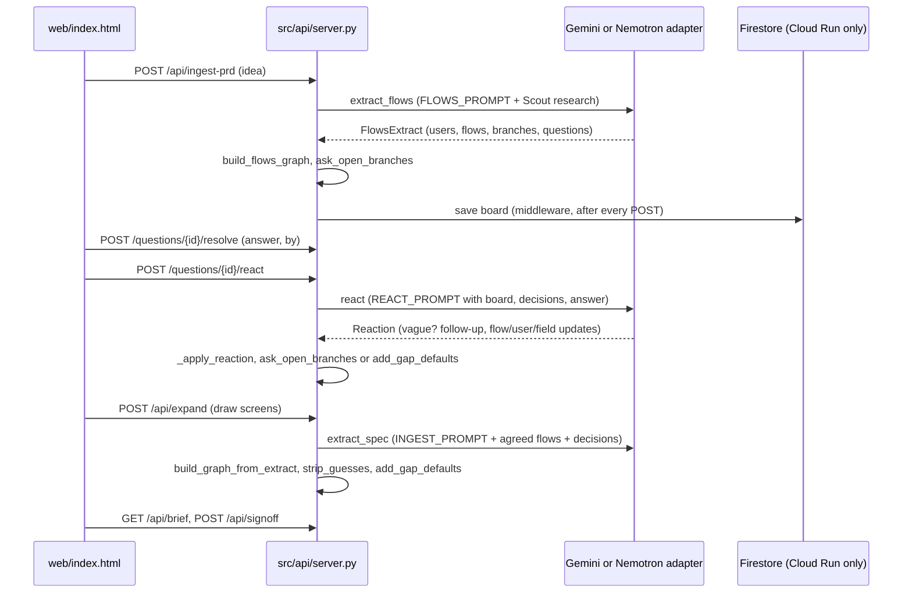

# BuildingBees architecture

For engineers and coding agents working on this repo. Read this before changing the prompts, the board or the question rules.

## The idea in one paragraph

A team describes a product in a line or a PDF. An engine (Google Gemini, or NVIDIA Nemotron) returns structured JSON: users, user flows and questions. The questions belong to "bees" (roles: product, design, frontend, backend, testing, compliance). Each teammate answers only their bees' questions. After every answer a bee either asks one sharper follow-up (vague answer) or rewrites the board (clear answer). When the flows are agreed, the engine draws screens, buttons and APIs. Everything ends in a Markdown Brief that the client signs off and a coding agent can build from.

## Request flow



## Modules

| File | Responsibility | Key functions |
|---|---|---|
| `src/adapters/spec_prompts.py` | Every prompt and every output schema. Both engines fill the same Pydantic models. | `FLOWS_PROMPT`, `INGEST_PROMPT`, `INTERROGATE_PROMPT`, `REACT_PROMPT`, `XBranch`, `XFlowPlan`, `Reaction` |
| `src/adapters/gemini_adapter.py` | Gemini API with structured output; falls over across models and retries once after a short pause when Gemini is busy. | `_generate`, `extract_flows`, `extract_spec`, `react` |
| `src/adapters/nvidia_adapter.py` | Nemotron on Nebius Token Factory (OpenAI-compatible). Thinking is turned off so the JSON is not cut short. | `_generate` |
| `src/adapters/tavily.py` | The Scout Bee: one web search; results go into the prompt as untrusted reference text. | `research`, `as_prompt` |
| `src/core/ingest.py` | Turns engine output into the board graph, and owns the question rules that need no model call. | `build_flows_graph`, `build_graph_from_extract`, `clean_branches`, `ask_open_branches`, `add_gap_questions`, `add_gap_defaults`, `apply_gap_default`, `strip_guesses` |
| `src/core/graph.py` | The board (nodes, edges) and the "ready to build" rule. | `evaluate_branch_readiness` |
| `src/core/brief.py` | Writes the Brief from the board. No model call. | `build_brief`, `decision_count` |
| `src/api/server.py` | FastAPI app: one board per `X-Board` id, Firestore persistence, sign-in, rate limits. | `_apply_reaction`, `react_to_answer`, `expand`, `sign_off` |
| `web/index.html` | The whole UI, vanilla JS: canvas board, bee rail, question dock, roles, Brief viewer. | `renderMap`, `branchRows`, `drawWires`, `pmQueue`, `answer` |
| `src/api/feedback.py` | Testers' feedback board (Firestore `feedback`): reports, votes, comments, statuses, three confirmations resolve. | `create_report`, `toggle_vote`, `confirm_fixed` |
| `scripts/eval_questions.py` | Question-quality check on four sample ideas. Run after every prompt change. | `run` |

## The question rules (what the bees may and may not ask)

1. **Ask only product decisions.** The prompts forbid questions with an industry-standard answer (timeouts, retries, double taps, loading and error states, sign-in basics, pagination, file limits). Origin: a tester answered 70+ questions on 16 Oct 2026 and gave up.
2. **Standard details become defaults, not questions.** `add_gap_defaults` creates the detail question and answers it at once with the standard (`metadata.default = True`). The Brief lists these under "Standard defaults applied"; anyone can reopen one.
3. **Never ask what is already answered.** `_already_asked` drops near-duplicates (word overlap of 0.6 or more); the prompts also pass every earlier decision.
4. **Branches.** A flow can split after a step (`XBranch`). A path with a standard handling is drawn; a path that is a real product choice is left empty and `ask_open_branches` adds one Testing Bee question tagged `metadata.branch = "at_step|label"`.
5. **Vague answers** get exactly one sharper follow-up from the same bee and change nothing.
6. **Assumption is not approval.** Values nobody stated (a vendor, a timeout) are blanked by `strip_guesses` and then defaulted or asked.

## Who is answering (solo or team)

`AUDIENCE` in `spec_prompts.py` is put in front of every engine call (`server.audience()`): solo means at most 6 plain questions per stage with a recommendation and a "why"; team means up to 12, routed and worded by role. The board's `mode` is stored with it and can be switched with `POST /api/mode` (inviting a teammate does this).

**The person decides when the board changes.** Nothing redraws after each input. Solo boards ask in sets (`pmSet()` in `web/index.html`: every open question about one flow or screen, topped up to 3, capped at 7); saving a set calls `/resolve` with `later: true`, which marks each answer `metadata.pending`. Every card (step, split, side path, screen) has a Figma-style pin: a bee with a count when bees have questions about that part (click to reply in a thread), or a speech bubble for people's own notes (`POST /api/comments`, stored in `g.comments` with status `open` or `applied`). A tray shows what is waiting; "Update the board" calls `POST /api/questions/react-batch` with no ids, which sends every pending answer and open note in one `REACT_PROMPT` call with `BATCH_NOTE` in front, then marks them applied. Notes also feed `/api/expand` and appear in the Brief under "Notes on the board". Team answers given in the dock still apply one at a time, because each person answers their own role's questions.

**Rounds (Roger's ritual, 18 Oct 2026).** Work moves in review rounds, the way his 7-day Figma plus Codex ritual did: publish a version, collect everyone's input, process it once, publish the next. `_start_round()` (server) freezes the round's questions: solo gets the 6 most important open ones (`ROUND_BUDGET`, blocking first), so the count never grows mid-round; a team gets all. Processing a round (`react-batch`) writes a changelog entry to `g.rounds` (answers, notes, what changed, the bees' note), bumps `g.round` and starts the next. On a team board only the owner or the product manager may process a round or edit steps (`_may_process`, from the board's `owner` and the `X-Role` header); everyone else adds answers and notes, which wait. Solo shows Update the board at 7 inputs or when the round is answered. Drawing the screens closes a round too.

**Short ids.** `short_ids()` in `src/core/brief.py` gives every user, flow, screen, button and API a short id once (U1, FL1, S2, B3, A1) and keeps it through rounds and redraws; features are F1, F2 on `g.features`, written with the flows (`FlowsExtract.features`). The board, the Brief and the plan use the same ids, as in the ritual, where "F1" on a screen linked to feature 1.

**Screens are specs.** Each wireframe element has a `detail` (a list's card fields, a choice's options). States only where real: `graph.screen_needs_states()` asks for loading when a screen shows a list or image and error when a button calls an API; readiness and the detail questions follow it. A screen is not ready while its flow has an open blocking question.

**Agent Platform and spend guards.** With `GEMINI_VERTEX_PROJECT` set, every Gemini call goes first to Agent Platform (Vertex AI) on our project: `gemini-3.1-pro-preview`, then 3.8 and 3.7 Flash, billed to the Free Trial credit; then the free API key chain; then Flash-Lite as an emergency. `GEMINI_VERTEX_DAILY_CAP` (300) bounds the calls a day, and a Rs 2,000 budget alert sits on the billing account.

**Plan check, share page, MCP (ideas from Archify).** `src/core/check.py` lists blockers and gaps (open blocking questions, undecided splits, must features with no flow, missing states, failure paths, timeouts, waiting notes); it heads the Brief and is `GET /api/plan-check`. `src/core/share.py` writes the board as one standalone page with anchors on every id (`GET /api/share`). `scripts/mcp_server.py` exposes get_plan, plan_check, open_questions and add_note to coding agents.

**Misalignments (Roger, 18 Oct 2026).** When answers or notes in a round disagree with each other or with an earlier decision, the model returns them in `Reaction.conflicts` instead of picking a side; they are stored on `g.conflicts`, block the plan check, and appear first in the dock for the owner or product manager, who settles each one (`POST /api/conflicts/{i}/settle`); the decision becomes a note applied in the next round.

**Adding a feature.** `POST /api/features` runs `extract_flows` with the board's users and flows as context and the new feature as the idea, then `merge_feature()` (`src/core/ingest.py`) adds only ids that are new: agreed flows, answers and screens are never rewritten. If screens exist they are flagged for a redraw. A product can have 1 to 6 flows (one per job the input names) and up to 3 branches per flow.

## Teams

- Roles live in the browser (`localStorage` keys `bb_role`, `bb_name`): `PM` hears every bee, `CLIENT` hears `PM` and `COMPLIANCE`, the others hear their own bee. See `ROLES` and `mine()` in `web/index.html`.
- `resolve` stores `metadata.answered_by`; the Brief prints it next to each decision.
- The board polls `/api/graph` every 15 s and reloads only when the node or answer count changed and the person is not typing.
- Sign-off (`POST /api/signoff`) stores `{by, at, decisions, open}` on the board; the Brief flags a sign-off once the decision count changes.

## Data

- Board state is the dict from `_state()`: nodes, edges, product name, spec text, entities, sources, sign-offs, `needs_redraw`.
- On Cloud Run it is saved to Firestore collection `boards` (document id is the SHA-1 of the board id, value is zlib-compressed JSON) after every successful POST. Locally boards live in memory and the browser keeps a backup copy.
- Signed-in users (Firebase Authentication, Google) get a list of their boards in collection `users`.

## Run, test, check, deploy

```bash
.venv/bin/python -m uvicorn src.api.server:app --port 8000
.venv/bin/python -m pytest -q
.venv/bin/python -m scripts.eval_questions gemini
```

Deploy: see "Deploy to Google Cloud Run" in the README. Keys come from `.env` and are passed with `--env-vars-file`; never commit them.

## Conventions

- Every function has a docstring saying what it does and why; comments explain the reason, not the mechanics.
- No em dashes in code, copy or docs.
- A prompt change is followed by `scripts/eval_questions.py` and the numbers go in the commit message.
- New behaviour gets a test in `tests/test_gemini_ingest.py` that uses the fake engines, never a real model call.
